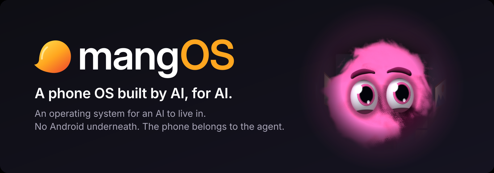
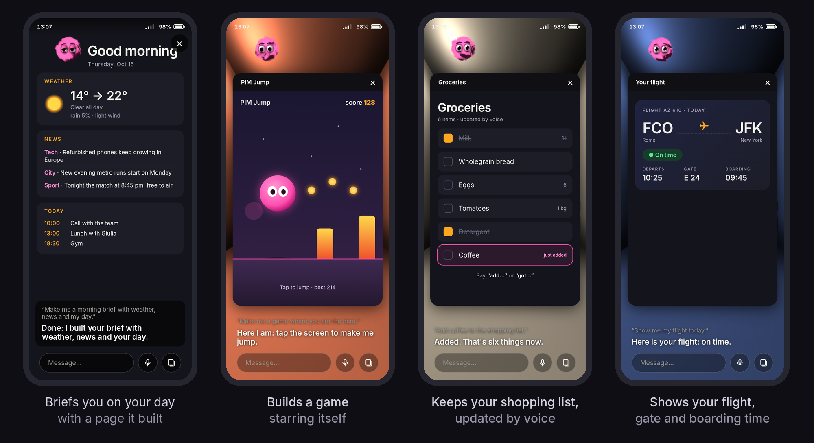
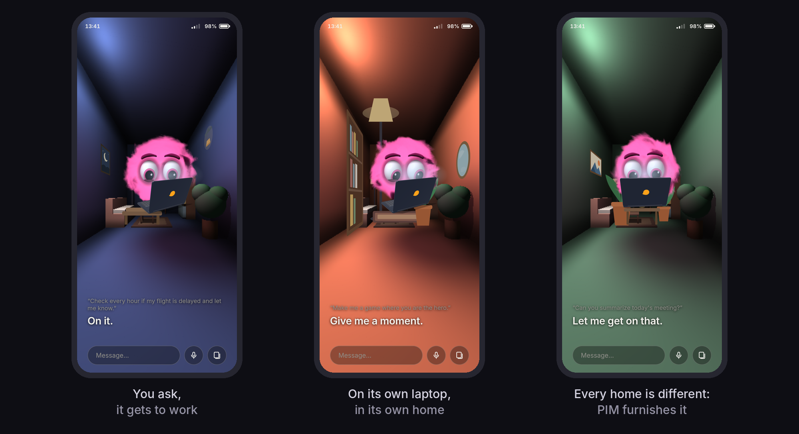

<p align="center">
  
</p>

<p align="center">
  <a href="LICENSE"></a>
  
  
  
  
</p>

<p align="center">
  <b>Your old phone, reborn as an AI's body — and the AI lives inside it.</b>
</p>

<p align="center">
  <a href="#what-it-is">What it is</a> ·
  <a href="#what-pim-can-do">What PIM can do</a> ·
  <a href="#privacy">Privacy</a> ·
  <a href="#what-works">What works</a> ·
  <a href="#build-your-own">Build your own</a> ·
  <a href="#how-it-was-built">How it was built</a> ·
  <a href="#roadmap">Roadmap</a>
</p>

<p align="center">
  
  <br>
  <sub>The screens in this and the next image are illustrations of the kind of page PIM makes. The
  data in them (weather, news, calendar, flight) is made up, and mangOS has no calendar or
  scheduler.</sub>
</p>

> **Early development.** mangOS is a project in progress and this is a first version: much works,
> much is still missing, and things change quickly.

## What it is

mangOS is an operating system for an AI to live in: a computer inside a phone, where Claude Code
works.

If the AI runs in the cloud anyway, the machine it works on does not need to be big. A phone is a
low-power alternative to a mini PC: it has a screen, a camera, a microphone, a speaker, sensors and
a battery, it uses little energy, it can stay at home on the charger or travel with you. And
almost everyone has an old one in a drawer that they no longer know what to do with.

There is no Android underneath. Under mangOS there is a Linux kernel, and nothing else between it
and the hardware. On top there is no app launcher and no home screen. The phone belongs to the
agent, and the agent is the interface: you talk to it, and it shows you what you need on the
screen, then takes it away.

It runs on a Samsung Galaxy M13, a budget phone from 2022. The WEEE Forum estimated that 5.3
billion phones would be thrown away in 2022
([reported by The Register](https://www.theregister.com/2022/10/14/international_e_waste_day/)).
mangOS is the other option: your old phone, reborn as an AI's body, and the AI lives inside it.

This is a phone OS built by AI, for AI. The kernel drivers and the system were written by Claude
Code agents, directed by one person who is not a kernel developer. Audio, cameras and sensors
were brought up on hardware that had no working Linux support, using the vendor's source code,
measurements, and a lot of testing on the real phone. It works, and the code is here.

The agent is called PIM. It is a name chosen by the owner of the phone: the system is mangOS, the
entity that lives on it can be anyone.

## What PIM can do

<p align="center">
  
</p>

- **See.** It looks through the rear and front cameras, and you see in a small window what it
  sees. Point the phone at something and ask "what is this?".
- **Listen and speak.** You talk to it and it answers aloud. Speech is transcribed and spoken on
  the phone ([Parakeet](https://huggingface.co/nvidia/parakeet-tdt-0.6b-v3) and a
  [Piper](https://huggingface.co/rhasspy/piper-voices) voice) or in the cloud (Deepgram), as you
  choose with `pim speech`. The default Italian voice is for research and non-commercial use; see
  [NOTICE](NOTICE).
- **Feel the world.** It reads the accelerometer, the temperatures, the battery, the load, the
  frequencies of its own processors.
- **Make things.** It writes pages and games and shows them on the screen, in a window or as the
  background. They stay in a collection you can open again.
- **Furnish its home.** The agent appears as a ball of smoke in a 3D room. It can paint the walls,
  draw objects and place them.
- **Change its own interface.** The UI is one web page, and PIM is allowed to edit it (and the
  bridge, and its own commands) when you ask for something the UI cannot do.

The language model runs in the cloud, through [Claude Code](https://claude.com/claude-code) with
your own Claude subscription: one agent (Haiku by default), or two, where Haiku talks and Sonnet
does the heavy jobs (`pim agents`). The interface and the agent speak Italian; see
[docs/DEVELOPMENT.md](docs/DEVELOPMENT.md#changing-the-language) if you want another language.

## Privacy

- **Speech stays on the phone unless you choose the cloud.** By default the microphone is
  transcribed and the replies are spoken on the phone: the audio does not leave it, only its text
  goes to Claude (below). With
  `pim speech cloud`, Deepgram does both: the microphone audio is streamed to Deepgram, and the
  text of every reply is sent to it to be spoken. It needs your Deepgram key.
- **Claude always runs in the cloud.** It receives everything you say or type to PIM, its own
  replies, and whatever PIM reads or looks at: photos it takes, files, web pages.
- **The agent has the run of the phone.** What that exposes is in
  [Security](docs/ARCHITECTURE.md#security).

## What works

Kernel 7.3 on the Exynos 850, based on [exynos850-mainline](https://github.com/exynos850-mainline).
Audio, the two cameras and the motion sensors work on mainline Exynos 850: we know of no other
project that has them. They need small kernel modules of our own that start the original Samsung
firmware (the modules are in `mangos/tools/`; the firmware is not included).

| Part | State |
|---|---|
| Screen and UI | Works. A WebGL UI at up to about 55 frames per second (it draws less when nothing moves), using the framebuffer the bootloader sets up. Boot logos are ours |
| Touchscreen | Works (Himax HX83112F, BOE panel) |
| GPU | Mali-G52 with `panfrost`; raised to 1001 MHz while the screen is on, lowered when it is off |
| CPUs | 8 cores, 130 to 1846 MHz, `schedutil`. They slow down from 76 °C |
| Temperature | Three chip sensors (two CPU clusters, GPU) and the battery |
| Memory and storage | 3.8 GB RAM, no swap, eMMC, file system checked at every boot |
| Wi-Fi | Works (Samsung SCSC), supervised and reconnecting by itself, factory MAC address |
| Clock | RTC, and network time over Wi-Fi |
| USB | Network gadget toward a PC (`172.16.42.1`) |
| Battery and charging | Level, voltage, current, temperature; charges at the bootloader's values (500 mA) |
| Keys, power off | Works. Power off shows the charging battery when the cable is in |
| Vibration | Works |
| Microphone | Works. Transcription on the phone (Parakeet) or in the cloud (Deepgram) |
| Speaker | Works. Speech on the phone (Piper) or in the cloud (Deepgram), streamed phrase by phrase; pages can play sound too |
| Cameras | Rear (with autofocus) and front, one at a time, with live preview. No image processor: development, exposure, focus and colors are done in software |
| Accelerometer | Works |
| Compass | Reads, but is not calibrated (open problem) |
| Agent | Claude Code as the entity: one session, or two (one talks, one works) |
| Watchdog | A hung kernel reboots the phone within about a minute |
| Not yet | Headphones and earpiece, Bluetooth, GPS, SD card, suspend, CPU idle states, fingerprint reader, calls and SMS |

The open problems and the planned work are in the [Roadmap](#roadmap).

## Architecture

```
Samsung bootloader (signed, kept)
  -> boot partition: Android boot image -> uniLoader
       inside: Linux 7.3 + M13 device tree + ramdisk
  -> ramdisk: USB network, e2fsck, mounts the system from userdata
  -> mangOS (Alpine Linux base, /mangos on the system partition)
       fallback system if a boot did not finish: Nura (postmarketOS) rootfs
  recovery partition: test kernels (never the only kernel)

mangOS services
  mangos-web        cage compositor + Chromium kiosk -> the UI (one WebGL page)
       ^  HTTP, localhost only
  mangos-bridge     serves the UI, state, keys, touch, screen, GPU, voice conversation
       ^
  mangos-agent      Claude Code as user "pim": one session, or two (a talker and a worker)
       ^
  pim               the command the agent uses to drive its screen, room, camera, voice
  mangos-parakeet   speech to text on the phone    mangos-speak   text to speech, phone or cloud
  mangos-sound      mixes everything that plays    mangos-photo   camera service
  mangos-wifi, mangos-dhcp, ntpd                   Wi-Fi, address, network time
  mangos-usbnet, mangos-watchdog                   USB network, reboot of a hung kernel

Kernel side
  kernel/           our device tree and drivers (charger and fuel gauge, backlight, touchscreen)
  kernel-patches/   fixes to code that is not ours (CPU clocks, Wi-Fi, RTC)
  mangos/tools/     our modules: abox (audio), chub (sensors), camera, acpm_gpu, acpm_thermal,
                    reboot_target
```

The full description (boot chain, the two kernels, services, bridge, agent, kernel modules, files
on the phone, hardware, security) is in [docs/ARCHITECTURE.md](docs/ARCHITECTURE.md).

## Build your own

We built mangOS on a Galaxy M13 because that is the phone we had at home. We have others, and we
will try it on them too. But the idea is not that you buy an M13: take this code as a starting
point, fork it and adapt it to the phone in your own drawer.

The way the project is laid out is meant to make that road shorter: the parts specific to the
phone (boot chain, device tree, drivers, firmware) are separate from the parts that run on any
Linux (UI, bridge, agent, voice), and [docs/PORTING.md](docs/PORTING.md) walks through what to
change. You will most likely need an AI coding agent such as Claude Code to do it, as we did.
[docs/LESSONS.md](docs/LESSONS.md) lists the problems we met, with their causes and what to check
first: many will come up on your phone too. Expect more headroom on a more powerful phone, and
more modest results on an older or weaker one.

To rebuild it on the same phone you need a Galaxy M13 (`SM-M135F`), a Windows PC with WSL2 (Ubuntu 24.04) and `usbipd-win` (a
native Ubuntu PC should work, but it has not been tried), a USB cable, and a Claude subscription
for the agent. Samsung's firmware is not included: you extract it from your own phone.

> **Risk.** You can make the phone unusable. Unlocking the bootloader wipes it and trips the
> Samsung warranty flag, and there is no way back to Android without the full original firmware:
> dump it first. There is no warranty. The boot images and system archives you build contain
> Samsung firmware: do not publish them.

The full procedure, how to check each step, and what to change for another phone are in
[docs/PORTING.md](docs/PORTING.md). Some steps have not been repeated from zero on an empty
phone: the guide says which.

To work on the code, give your AI agent [CLAUDE.md](CLAUDE.md): it is short, and points to
[docs/DEVELOPMENT.md](docs/DEVELOPMENT.md) (the work cycle and the safety rules) and to
[docs/LESSONS.md](docs/LESSONS.md) (problems already found).

## How it was built

The method matters as much as the result.

- **Agents write, a person directs.** Claude Code agents wrote the drivers, the system and the
  UI. One person chose the goals, kept the plan, and decided. Nobody on the project is a kernel
  developer.
- **Search first, specification before driver, small steps on real hardware.** Look for who
  already did it; write what the hardware needs from the vendor's source, with file and line;
  test every change on the phone, one at a time. The details are in
  [docs/PORTING.md](docs/PORTING.md#advice-from-the-method).
- **Write down every problem**, including the wrong turns. The result is
  [docs/LESSONS.md](docs/LESSONS.md): symptom, cause, how it was found, what to check first.

## Roadmap

- **An agent that maintains its own body**, kernels included: builds, tests in `recovery`, and
  promotes a kernel to `boot` only after it has worked.
- **Open points:**
  - compass calibration (the reading is about 400 microtesla, Earth's field is about 50);
  - headphones and earpiece, Bluetooth, SD card, suspend, USB host and fast charging;
  - calls and SMS through the modem;
  - CPU idle states and lower memory and bus frequencies at rest, automatic GPU scaling;
  - a mainline audio driver in place of our module (the sound already reaches it through a
    virtual ALSA card), and a real display driver instead of the bootloader's framebuffer;
  - memory that runs out freezes the phone and the watchdog does not reboot it (no swap);
  - the system builder (`scripts/build_mangos_rootfs.sh`) has never been run end to end on an
    empty phone;
  - the ramdisk's rescue shell has no password and uses a USB identifier that belongs to another
    company.

## License

GPL-2.0-only, as the kernel drivers have to be. See [LICENSE](LICENSE). Copyright (C) 2026
Federico Anastasi. Third-party material is listed in [NOTICE](NOTICE). Samsung firmware is
proprietary and is not included: you extract it from your own phone.

mangOS is an independent project, not affiliated with or endorsed by Samsung or Anthropic. Samsung
and Galaxy are trademarks of Samsung Electronics; Claude and Claude Code, of Anthropic.
